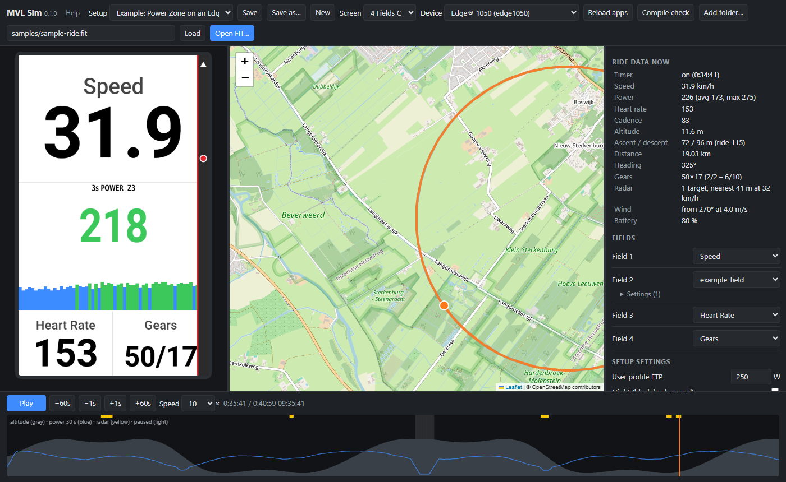

# MVL Sim

A ride emulator for Garmin Connect IQ **data fields**. It replays a recorded `.fit` activity through your
data field's own Monkey C code, in the browser: the device screen on the left, the ride on a map, and a
timeline you can scrub. Seeking replays the ride from the start (a 3 h ride takes about 0.1 s), so the
field's own running state (averages, smoothing, counters) is exact at any point you jump to.



It is meant for the edit-look-edit loop: change a `.mc` file, press **Reload app**, and the same
moment of the same ride is on screen again a second later. Garmin's simulator is still the reference
before you put a build on a device.

Stage 1 covers data fields only (`DataField` and `SimpleDataField`). Watch faces, widgets and device
apps are not supported.

Version 0.1.0 (see `CHANGELOG.md`). This is a spare-time tool, provided as is (see the licence). Bug
reports with a small project and FIT file that show the problem are welcome; there is no promise of
support or of a fix by any date.

## Quick start

1. Install Node.js 18 or newer, and the Connect IQ SDK with at least one device (Garmin's SDK Manager).
2. Start MVL Sim with your data field's project folder: `start.cmd C:path	omy-datafield` on Windows,
   `./start.sh ~/path/to/my-datafield` on macOS or Linux. The page opens in your browser.
3. Pick the device and the screen layout, and put your field in one of the screen's fields.
4. Open `samples/sample-ride.fit` (a made-up ride, see below), or a `.fit` file of your own ride, and
   press play.
5. Edit your `.mc` files and press **Reload apps**.

No data field of your own? In the MVL Sim folder, start it with its `samples` folder (`start.cmd samples` or
`./start.sh samples`), pick the setup **Example: Power Zone on an Edge 1050** and open
`samples/sample-ride.fit`. Or start it without a folder and build a screen of the device's own fields.
**Help** at the top of the page opens this README.

## Requirements

- Node.js 18 or newer. No npm packages; nothing to install.
- The Connect IQ SDK and the device files of the devices you want to emulate, installed with Garmin's
  SDK Manager. MVL Sim reads them from your own installation and never ships or copies Garmin files.
- A modern browser (Chrome, Edge, Firefox). The map uses OpenStreetMap tiles and Leaflet from unpkg.com.

## Privacy

Everything runs on your own computer. Your FIT files, projects and setups are never uploaded anywhere,
and MVL Sim collects nothing. Two things come from the internet: the map library (Leaflet, from
unpkg.com) and the map tiles (from OpenStreetMap's tile servers). So OpenStreetMap sees which map area
you look at, as with any web map, which tells it roughly where the ride was. MVL Sim does not send it the
ride itself.

## Samples

`samples/sample-ride.fit` is a made-up 40-minute road ride, so you can try MVL Sim without a ride of your
own. Nothing in it comes from a real ride. It has two laps of a 10 km circle (it does not follow roads)
with a hill, power, heart rate, cadence, gear changes (2x11), a 1-minute pause, cars on the radar (and
the radar off for a while), FTP 250 W and the battery level. `samples/make-sample-ride.mjs` writes it
(`node make-sample-ride.mjs`); the output is the same every time.

`samples/example-field` is a small data field to try MVL Sim with: 3 s power in big digits coloured by
power zone (% of FTP, a setting), over a bar graph of the last 60 seconds. `samples/example.mvlsim.json`
puts it on an Edge 1050 data screen between the device's own speed, heart rate and gears fields, as in
the screenshot above.

## Start

Windows: double-click `start.cmd`, or run it with your project folder:

```
start.cmd C:\path\to\my-datafield
```

macOS / Linux:

```
./start.sh ~/path/to/my-datafield
```

Both start the server and open http://localhost:8137/. The server stops by itself about 15 seconds after
the last MVL Sim page is closed (or close its window). Starting it again while one is running stops the
running one and takes its place, so a new start always runs the current code. Without the browser:
`node server.mjs [options] [project-or-folder ...]` (runs until Ctrl+C unless `--stop-when-closed`).

A path can be one project (a folder with `manifest.xml`) or a folder with projects below it (searched three
levels deep). Without a path MVL Sim uses `projects` from `config.json`, else the current folder. More
folders can be added in the page (**Add folder…** opens a folder browser); the page remembers them.

Options (each also as an environment variable and as a key in `config.json`):

| Option | Environment | `config.json` | Meaning |
|---|---|---|---|
| `--port N` | `MVL_SIM_PORT` | `port` | Port (default 8137) |
| `--ciq <dir>` | `MVL_SIM_CIQ` | `ciq` | Connect IQ folder with `Sdks/` and `Devices/` (default per OS, see below) |
| `--sdk <dir>` | `MVL_SIM_SDK` | `sdk` | SDK folder (default: the SDK Manager's current SDK, else the newest) |
| `--key <file>` | `MVL_SIM_KEY` | `key` | Developer key for **Compile check** (default: VS Code's `monkeyC.developerKeyPath`) |
| `--setups <dir>` | `MVL_SIM_SETUPS` | `setups` | Default folder for setup files (default `MVL Sim` in your Documents folder; home folder if there is none) |
| `--config <file>` | | | Config file (default `config.json` beside `server.mjs`) |
| `--open` | | | Open the page in the default browser (implies `--stop-when-closed`) |
| `--stop-when-closed` | | | Stop the server when the last page has been closed for 15 s |
| `--version` | | | Print the version and exit |

Default Connect IQ folder: Windows `%APPDATA%\Garmin\ConnectIQ`, macOS
`~/Library/Application Support/Garmin/ConnectIQ`, Linux `~/.Garmin/ConnectIQ`. Copy
`config.example.json` to `config.json` to keep your settings; `config.json` is gitignored. Relative paths in
it are relative to the config file.

The server listens on 127.0.0.1 only, answers only its own page, and only serves files from the project folders
you gave it, the SDK's fonts and `.fit` files you open. For the folder browser it lists folder names (not files).

## Use

A **setup** is one data screen: a device, a screen layout and what each field shows. A field shows either
one of your Connect IQ data fields (any project MVL Sim found, with its jungle file, language and
settings) or the device's own data (speed, heart rate, 3s power, cadence, distance, timer, ascent, time of
day, ...). So you can put your field next to the normal ones, or several Connect IQ fields (your own and
other people's) on one screen. Every app runs on its own, with its own classes, storage and settings, as
on the device.

Pick the setup (or start with **New**) and set the device, screen and fields. Before a FIT file is open the
screen shows the device switched on but not recording (no sensors, timer off, current time), so the
fields can be set up first. Then open or drop a `.fit` file (or paste its path) to play a ride.

- **Save** / **Save as…** write the setup to a `*.mvlsim.json` file. **Save as…** asks for a name and a
  folder: the default setups folder (`Documents/MVL Sim`, or `--setups`), a project folder, or any other
  existing folder (remembered by the browser). Setups in all these folders (three levels deep) appear in
  the **Setup** list. App paths in the file are relative when the app is close to the file (so a setup can
  be committed next to the apps it uses), else absolute. Unsaved changes are kept by the browser.
- No data field of your own is needed: a setup of the device's own fields shows how a data screen will
  look and lets you check it against a ride you have done.
- **Screen**: the device's data screen layouts from its `simulator.json` (1 field, 2 fields, ...).
  `getObscurityFlags()` follows the field. Fields keep their content when the layout changes, as far as
  the new layout has fields.
- **Fields** (side panel): one picker per field. For a Connect IQ field, its jungle file, language and
  settings from `properties.xml` / `settings.xml` are under the picker; a change replays that app.
  The device's own fields use its built-in fonts and label/value positions, in the setup's units. Besides the
  values of `Activity.Info` there are Normalized Power and Lap NP (match the NP the Edge wrote for 2 rides
  and 19 of 20 laps), Lap Time, and Grade (altitude change over the last 50 m; Garmin's smoothing is not
  published, so this is close, not exact).
- **Radar bar**: when the ride has radar data, the device's radar strip is drawn on the right edge while a
  vehicle is behind. The rider is at the top; each vehicle is a dot that starts at the bottom (140 m back)
  and moves up as it closes in, amber when approaching, red when approaching fast (closing at 9 m/s or
  more). The track's edge shows the highest threat and the track turns green for 3 s once clear. Garmin
  also sizes the icon by vehicle size, which the FIT file does not record. An approximation of Garmin's
  look; it can be switched off.
- **Radar view** (a device field, like the Edge's half-screen radar): the road behind as a lane with the
  rider at the top and a car shape per vehicle coming up from the bottom, amber or red by closing speed;
  the lane's edges show the highest threat, green when clear, grey when the radar is off. Put it in a big
  field (for example the top of "3 Fields A"); the side strip is not drawn while it is on the screen.
- **Radar (full screen)**: the same lane for a 1-field screen, with distance marks every 25 m and the
  nearest vehicle's distance (m) and closing speed (km/h), and the vehicles passed so far (the FIT file's
  `radar_current`, when the ride has it).
- **Setup settings**: units, night mode, radar bar, weather, wind and the user's FTP, shared by all fields.
  **Units** is metric or statute (miles, mph, feet, °F; the radar views in yards): the device's own fields
  follow it, and `System.getDeviceSettings()` reports it to the apps as `distanceUnits`, `elevationUnits`,
  `paceUnits`, `heightUnits`, `temperatureUnits` and `weightUnits` (all the same; the device can set them one
  by one). The side panel's ride data stays metric.
- Drag the dividers between the device screen, the map and the side panel to resize them (double-click
  resets one); the screen scales to its column. Click the screen for actual pixels (1:1).
- Space = play/pause, arrows = ±1 s (Shift ±60 s), drag the timeline or click the map to jump.
- **Reload apps** re-reads the sources and resources after an edit.
- **Compile check** runs the real `monkeyc -l 3` for every Connect IQ field of the setup (output to the
  temp folder) and shows the compiler's messages.
- FIT developer fields the apps write (`createField` / `setData`) are listed in the side panel, and
  `System.println` output appears in the app log, tagged with the field when there are several apps.
- URL parameters for a direct start: `?setup=<path>&fit=<path>&t=<seconds>`, or for one app
  `?app=<name or path>&device=<id>&jungle=<file>&fit=<path>&t=<seconds>`.

Example setup file:

```json
{
  "mvlSim": 1,
  "name": "Edge 1050, 4 fields",
  "device": "edge1050",
  "layout": "4 Fields A",
  "fields": [
    { "metric": "speed" },
    { "app": "../apps/my-field", "jungle": "monkey.jungle", "lang": "eng", "settings": { "ftp": 250 } },
    { "app": "../apps/other-field" },
    { "metric": "power3s" }
  ],
  "night": false,
  "weather": "auto",
  "wind": { "bearing": 270, "speed": 4 },
  "userFtp": null,
  "units": "metric"
}
```

### What it reads from your project

- `manifest.xml`: app type, products, languages.
- Jungle files: `sourcePath`, `resourcePath`, `excludeAnnotations`, `lang.<code>`, with device, family
  and shape qualifiers resolved through the SDK's own `default.jungle` (for example
  `edge1050.resourcePath`, `rectangle-480x800.resourcePath`, `round.excludeAnnotations`).
- Resources: strings, fonts (`.fnt` bitmap fonts), bitmaps, properties and settings, JSON data,
  layouts (labels, bitmaps, drawable classes), including `resources-<device>` and language folders.
- Annotations `:release` and `:test` are excluded, as in a debug build.

### Inputs from the FIT file

Power, heart rate, cadence, speed, altitude, distance, calories, pressure, position, timer state
(start/pause/resume/lap call the `onTimer*` callbacks; a lap starts at each lap's `start_time`), gear changes (shifting events), radar (the radar
developer fields `radar_ranges` / `radar_speeds`), FTP / threshold HR / max HR (zones target and user
profile messages, as `UserProfile`), sport, local time offset, weather (`weather_conditions`, rarely
present), battery level (`System.getSystemStats().battery`: Garmin's undocumented message 104, which
Edge files write about once a minute, or `device_info` battery_level; 80 % when the file has neither).

Derived: heading (from the GPS track), total ascent and descent (2 m hysteresis, scaled so the end
equals the session's own totals), averages and maximums for `Activity.Info`. Wind can be set by hand.

## How it works

`web/monkeyc.js` translates Monkey C to JavaScript. `web/runtime.js` has Monkey C number semantics
(32-bit Number, 64-bit Long, 32-bit Float, Double, Char; truncating division and `%d`, round-half-even
`%.nf`) and a stand-in for the Toybox API a data field uses. `web/fit.js` and `web/ride.js` turn the FIT file into one
`Activity.Info` a second, and `web/sim.js` calls `compute()` once a simulated second and `onUpdate()` on
a canvas; `web/builtin.js` draws the device's own fields around it. Each simulated app has its own
runtime (classes, storage, properties), so each field of a screen can run a different app (`web/screen.js`). The server (`server.mjs`, `bundle.mjs`, `jungle.mjs`, `ciq.mjs`) finds the SDK and devices and
reads projects.

Language support: modules, classes and inheritance, `static`, `const`, `hidden`, `enum` (also in
modules), `import` / `using ... as` (a superclass's own name also works inside a class, as in Monkey C), `has`, `instanceof`, `switch` (with nested loops and fall-through),
`try` / `catch` / `finally` with Monkey C exceptions, lambdas via `method(:name)`, Arrays,
Dictionaries, ByteArrays (including `encodeNumber` / `decodeNumber`), Strings, `format`, `Long`, `Char`.
Anything the translator does not know is an error with file and line, not a silent difference.

Toybox modules with a stand-in: Lang, Graphics (Dc, fonts, bitmaps, buffered bitmaps), Activity,
Application (Properties, Storage), WatchUi (View, DataField, SimpleDataField, layouts and drawables),
FitContributor, System, Time (and Gregorian), Math, UserProfile, AntPlus (shifting, radar), Weather,
Position, Sensor, Timer, StringUtil. A call to something missing is reported as
`Toybox.X.y is not available in MVL Sim yet` with file and line.

Tests: `node test/smoke.mjs` needs no SDK, Garmin files or browser. It checks the sample ride, runs
the example field over it and starts the server, and runs on Linux, macOS and Windows in CI.

## Fidelity

Checked against Garmin's simulator (SDK 9.3.0, 2026-11-10):

- Bitmap fonts (`.fnt`) measure exactly the same (a missing glyph takes half the line height).
- Built-in TTF font heights match exactly and widths within 1-3 px (size pt × ppi / 72, "narrow" fonts at
  87.5 %).
- `format`, Float `toString`, `/` and `%` give the same results.
- A `SimpleDataField`'s label and value sit where Garmin's simulator draws them (text baselines from
  `simulator.json`; checked on edge1050, 2026-11-12).
- A language test (modules, static, enums, switch, Long, Char, ByteArray, format, JSON, exceptions) prints
  the same results in both.

Tried with other developers' data fields: SinceStopped (edge1050, matches Garmin's simulator, including
its cut-off label), ciq-battery-field (edge1050 and edge830, battery level from the file; on edge830 the
label and number land on the same pixels as in Garmin's simulator) and EveryTile (edge830 and edge1030, `.cft` fonts, see below; tiles
counted match the tiles of the GPS track).

Calibrated on edge1050 and edgemtb; other devices use the same rules from their `simulator.json`.

## What it does not do

- **Memory limits and memory use.** A field that runs here can still run out of memory on the device.
  Use Garmin's simulator and its memory view.
- **Real device timing.** `compute()` and `onUpdate()` run exactly once a simulated second, in that order.
- **Garmin `.cft` fonts.** Many devices (for example Edge 530) ship their built-in fonts as `.cft`. MVL Sim
  does not read that format; it shows a warning and draws those fonts with a stand-in TTF from the SDK.
  For the `.cft` Edge models (Edge 130 and 130 Plus, 520 and 520 Plus, 530, 820, 830, 1000, 1030 and 1030 Plus, Explore) the font
  heights and text widths were measured in Garmin's simulator (SDK 9.3.0): heights match exactly, text
  widths within a few pixels (digit strings in the small text fonts up to ~10 % narrow), the digits of
  the number fonts have Garmin's height and baseline (within 1-2 px), glyph shapes differ. Other `.cft` devices get an estimated size.
- Anti-aliasing details, Garmin's own total-ascent algorithm.
- Drawable lists in resources (`<drawable-list>`), `Dc.drawAngledText` / `drawRadialText` /
  `drawOffsetBitmap`, `SensorHistory`, `Communications`, `Background`, barrels. These report an error.
- Integer–Float promotion with `Long` follows the documented rules but is not yet checked against the
  simulator.
- The device's own fields only approximate the Edge's look (no unit labels, Garmin's label texts may
  differ).
- There is no phone connection; the battery is never charging.
- Watch faces, widgets, device apps (planned later).

Before you put a build on a device, Garmin's simulator and the device itself stay the test.

## Related tools

- **Garmin's Connect IQ simulator** (in the SDK) can play back a `.fit` file (Simulation > FIT Data), but in
  that mode the data field gets no speed, altitude or position. **MonkeyGraph** (also in the SDK) plots
  the FIT developer fields an app wrote.
- [bayville/garmin-connectiq-devkit](https://github.com/bayville/garmin-connectiq-devkit),
  [matco/connectiq-tester](https://github.com/matco/connectiq-tester): build and test automation around
  Garmin's simulator.
- [bombsimon/garmin-screenshot](https://github.com/bombsimon/garmin-screenshot),
  [duyatuan/owl-watch-simulator-mcp](https://github.com/duyatuan/owl-watch-simulator-mcp): screenshots
  and remote control of Garmin's simulator.
- [gcaufield/MonkeyTest](https://github.com/gcaufield/MonkeyTest): unit testing for Monkey C.
- [thisdougb/SinceStopped](https://github.com/thisdougb/SinceStopped): a data field project that
  tests its logic outside the device.
- [markw65/prettier-extension-monkeyc](https://github.com/markw65/prettier-extension-monkeyc) and
  [markw65/monkeyc-optimizer](https://github.com/markw65/monkeyc-optimizer): a Monkey C parser,
  formatter and optimizer. MVL Sim uses its own parser and does not depend on them; their grammar is a
  good reference.

## Licence

MIT, see `LICENSE`. Garmin, Connect IQ and Monkey C are trademarks of Garmin Ltd. or its subsidiaries;
MVL Sim is not affiliated with Garmin.
